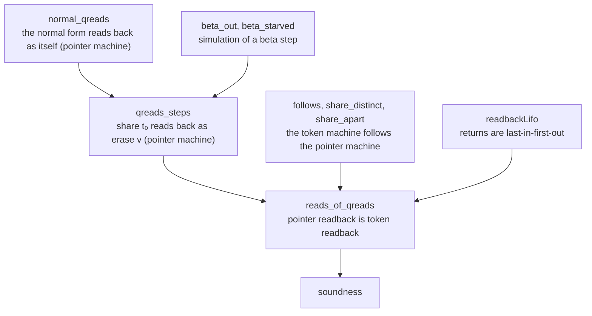

# Soundness of readback for the locally safe lambda calculus

*A summary of the Lean 4 formalization in this directory.*

## Abstract

Sharing graphs with labelled fans and no brackets or croissants (Lamping's abstract
algorithm; the nets of the Symmetric Interaction Calculus) do not evaluate every lambda term
correctly. Baillot, Coppola and Dal Lago [BCD] treat the terms typable in elementary and
light affine logic, on which the algorithm is sound, by means of a *context semantics*: a
token machine whose input–output behaviour on the initial graph determines the normal form
of the term.

This development proves the same statement for a different class of terms, the *locally
safe* simply typed lambda terms, which are defined by a condition on the orders of types and
not by stratification. The main theorem (`soundness`) says: if $t_0$ is closed and locally
safe, and the term $\mathsf{share}(t_0)$ carrying the initial sharing of $t_0$ reduces by
beta steps, in any order, to a normal form $v$, then the context semantics of
$\mathsf{share}(t_0)$ reads back as $v$.

The proof is checked by Lean 4.36 without Mathlib. It consists of about 8,300 lines, contains
no `sorry`, and depends only on the axioms `propext`, `Classical.choice` and `Quot.sound`.

The method of [BCD], preservation of the context semantics along reduction, is not
available here: three formulations of it are refuted in the development. The proof goes
through an auxiliary *pointer machine* that does not look at fan labels at all.

## 1. Definitions

All definitions live in the namespace `LSL`.

### 1.1 Terms, types and local safety

Types are simple types over one base type, $A, B ::= o \mid A \to B$, with
$\mathrm{ord}(o) = 0$ and $\mathrm{ord}(A \to B) = \max(\mathrm{ord}(A) + 1, \mathrm{ord}(B))$.
Terms are de Bruijn terms with a type on every binder
([Formalization/LSL.lean](Formalization/LSL.lean)).

A variable is *local* if its binder lies inside an argument, and *global* otherwise. A term
is *locally safe* if every argument of type $A$ mentions only those local variables whose
type has order at least $\mathrm{ord}(A)$. In Lean this is a typing judgement
`LS inArg Γ t A` in which the application rule checks the argument in a context where the
local variables of order below $\mathrm{ord}(A)$ are hidden; `LocallySafe t A` is
`LS false [] t A`. Global variables are never hidden. A checker `infer` is proved sound
(`infer_sound`), and local safety is preserved by beta reduction in any position
(`Step.safe`, `Steps.safe`).

### 1.2 Sharing paths

A term stands for a sharing graph. Each variable occurrence carries its *sharing path*: the
list of fan ports $(\ell, s)$, with $\ell$ a label and $s \in \{\mathsf p, \mathsf q\}$,
that lie between the occurrence and its binder.

* `share t` ([Formalization/Sharing.lean](Formalization/Sharing.lean)) gives a plain term
  its initial sharing. A variable with $n > 1$ occurrences is split by a chain of $n - 1$
  fans, each with a label used nowhere else. This is the counterpart of the
  distinct-labelling translation of [BCD].
* Beta reduction acts on paths: when $N$ is substituted for an occurrence with path $\pi$,
  $\pi$ is put in front of the path of every free variable of that copy of $N$ (`graft`).
  `Step` is one beta step anywhere in the term, `Steps` its reflexive–transitive closure.

### 1.3 The token machine

The context semantics ([Formalization/Token.lean](Formalization/Token.lean)) is given by a
token that walks over the term. Its state consists of a position (about to enter a subterm,
or leaving one upwards), one *exponential* stack of sides for each fan label, and one
*multiplicative* stack of sides.

| Position | Action |
| --- | --- |
| entering an application | push $\mathsf q$; enter the function |
| entering a lambda, $\mathsf q$ on top | pop; enter the body |
| entering a lambda, $\mathsf p$ on top | pop; leave upwards from the occurrence of the bound variable whose path can be popped from the exponential stacks |
| entering a bound variable with path $\pi$ | push $\pi$ on the exponential stacks; push $\mathsf p$; leave upwards from the binder |
| entering a free variable | output the stacks |
| leaving a body | push $\mathsf q$; leave the lambda |
| leaving a function, $\mathsf p$ on top | pop; enter the argument |
| leaving a function, $\mathsf q$ on top | pop; leave the application |
| leaving an argument | push $\mathsf p$; enter the function |
| leaving the root | output the stacks |

In all other cases the token is stuck. `Sem t c D T out` is the resulting partial function
from an entry point and stacks to an output.

### 1.4 Readback

Readback ([Formalization/Readback.lean](Formalization/Readback.lean)) recovers a term in
normal form from the semantics by queries at the root, as in [BCD]. A *point* $(D, U)$,
exponential stacks $D$ and a multiplicative stack $U$, stands for a subterm
$\lambda x_1 \dots x_n.\, y\, a_1 \dots a_m$ of the normal form.

* $n$ is the least number such that the token entering at the root with $(D, U\mathsf q^n)$
  produces an output.
* The multiplicative stack of that output has the shape
  $V\mathsf q^{l}\mathsf p\mathsf q^{m}$. It says that $y$ is bound by lambda $l$ of the
  point with address $V$, and that $y$ has $m$ arguments. Among the enclosing points with
  address $V$ the innermost is taken (`resolve`).
* Argument $i$ is the point $(E, V\mathsf q^{l}\mathsf p\mathsf q^{i}\mathsf p)$, where $E$
  are the exponential stacks of the output.

`Reads t anc D U u` is this relation, and `ReadsBack t u` is `Reads t [] Stacks.empty [] u`.
The result `u` is a pure lambda term (`Tm`); `erase` maps a term to its pure lambda term.
An executable `readback` with a step bound is proved sound for `Reads` (`readback_sound`).

### 1.5 Sharing graphs and sharing paths

This subsection is informal; nothing in it is formalized.

**Graphs.** An abstract sharing graph [BCD, Section 4] is built from lambda nodes,
application nodes and *fans*, each fan carrying an integer index. The initial graph of a
term is its syntax tree with every variable occurrence wired to its binder; where a variable
has several occurrences, the wires are merged by a tree of fans. [BCD] obtain this graph from
a proof-net of the term by deleting the boxes and turning each contraction node into a fan.
In the *distinct labelling translation* every contraction gets an index of its own.

**Paths.** A term with sharing paths is a notation for a sharing graph in which fans lie
only on the wires between variable occurrences and their binders. The path of an occurrence
lists the fan ports that are passed on the way from the occurrence to the binder. So a term
with paths is, in effect, a proof-net of [BCD] with indexed contractions and without boxes,
and `share t` is the distinct labelling translation, with a comb-shaped tree for each
variable. The transition table of Section 1.3 is the context semantics of sharing graphs
[BCD, Section 5] read along the term: lambda and application nodes act on the multiplicative
stack, and a fan with index $\ell$ pushes or pops the port taken on stack $\ell$. Entering
a variable therefore pushes its whole path, and returning through a lambda pops one.

**Reduction.** The two notions part ways under reduction.

* Rewriting of sharing graphs is local. A lambda facing an application is contracted; a fan
  facing a lambda or an application copies that one node; two fans facing each other
  annihilate if they have the same index and pass through each other otherwise. In between,
  fans of both orientations sit in the middle of the graph, and such a graph is not a term
  with paths.
* A beta step on terms with paths is the counterpart of a reduction step on proof-nets: the
  argument is copied or erased as a whole. The fans that select a copy reappear on the free
  variables of that copy (`graft`), as the new contraction nodes on the auxiliary doors of a
  copied box do; the fans inside the argument are copied together with their indices. In the
  graph, this is the state that the fans above the argument reach once they have travelled
  all the way through it, provided that fans meeting on the way are paired correctly. The
  index alone has to decide the pairing, and that is where the algorithm can go wrong.

**Semantics.** [BCD, Section 5] prove two facts of different strength. Every rewriting step
of a sharing graph preserves the context semantics exactly, because the rules are local;
this holds for all graphs, typed or not. A reduction step of a proof-net preserves it only
up to an ordering ≽, and this is stated for proof-nets of elementary affine logic.
Soundness then follows from the diagram

```text
⟦P⟧  ≽  ⟦Q⟧
 ‖
⟦G⟧  =  ⟦H⟧
```

in which the proof-net $P$ of the term reduces to the normal form $Q$, and its graph $G$
reduces to $H$; readback is correct on $Q$.

The theorem of this development takes the place of the top row. It says that readback
applied to the semantics of the initial graph yields the normal form, and it is proved
without a step-by-step relation between the semantics of a term and of its reduct, which
fails for locally safe terms (Section 3). Together with the bottom row it gives, on paper,
that every graph reached from the initial graph by rewriting reads back as the normal form
of the term. Whether rewriting terminates on the graphs of locally safe terms is not
addressed.

## 2. The theorem

```lean
theorem soundness {t₀ v : Term} {A : Ty} (hsafe : LocallySafe t₀ A)
    (hs : Steps (share t₀) v) (hn : ∀ v', ¬ Step v v') :
    ReadsBack (share t₀) (erase v)
```

([Formalization/PointerSound.lean](Formalization/PointerSound.lean).) The reduction is
arbitrary: any sequence of beta steps that ends in a normal form. `soundness_lo` in
[Formalization/Soundness.lean](Formalization/Soundness.lean) is the special case of
leftmost-outermost reduction.

Local safety cannot be dropped. Two machine-checked examples in
[Formalization/ReadbackExamples.lean](Formalization/ReadbackExamples.lean):

* The normal form $\lambda f.\, f\,(\lambda x.\, f\,(\lambda y.\, x))$ is typable but not
  locally safe. Its two inner lambdas have the same address, and readback returns
  $\lambda f.\, f\,(\lambda x.\, f\,(\lambda y.\, y))$.
* For the term `forbidden`, with normal form $\lambda x.\, x$, readback of the shared term
  fails.

## 3. Why preservation along reduction is not available

In [BCD] the reduction of proof-nets preserves the context semantics up to an ordering
(Section 1.5). Beta steps on terms with paths are the counterpart of that reduction. For
such steps, starting from `share t₀` with `t₀` locally safe,
[Formalization/Preservation.lean](Formalization/Preservation.lean) refutes three versions of
the statement:

| Statement | Content | Refuted by |
| --- | --- | --- |
| `StrictPreservation` | every output of the reduct is an output of the term (the first clause of the ordering of [BCD]) | `strictPreservation_fails` |
| `BetaSimulation` | the same up to a relation on exponential stacks, for all queries | `betaSimulation_fails` |
| `ReadbackPreservation` | what the reduct reads back as, the term reads back as | `readbackPreservation_fails` |

The last failure is caused by a step that erases an argument: in the term before the step,
the stacks can select an occurrence inside the argument that the step drops. A beta step on
terms duplicates and erases at once, so these refutations concern the term-level reduction
used here. They do not contradict the exact preservation of the semantics by the local
rewriting steps of a sharing graph.

The consequence for the proof is that the token machine is used only on `share t₀`, where
the labels of different binders are disjoint. Reduction is followed by a machine that is
insensitive to labels.

## 4. Structure of the proof



### 4.1 The pointer machine

The pointer machine ([Formalization/Pointer.lean](Formalization/Pointer.lean)) walks over
the term as the token machine does, but it never reads a sharing path. Where the token
machine pushes $\mathsf p$ on leaving a variable, the pointer machine pushes an *exit*
$\mathsf p(e)$ with $e = (o, \sigma)$: the address $o$ of the occurrence, and a list
$\sigma$ of saved log entries. Its state has a position, a *tape* of items $\mathsf q$ and
$\mathsf p(e)$, and a *log* with one exit for each argument around the token: the exit
through which that argument was entered.

* Entering a variable at $o$ whose binder lies $k$ arguments further out: the first $k$ log
  entries are moved into the new exit, $\mathsf p(o, \sigma)$ is pushed, and the token
  leaves upwards from the binder.
* Entering a lambda with $\mathsf p(o, \sigma)$ on top: the token leaves upwards from $o$,
  and $\sigma$ is put back in front of the log. The machine is stuck if the lambda does not
  bind $o$.
* Leaving a function with $\mathsf p(e)$ on top pushes $e$ on the log; leaving an argument
  pops it back onto the tape.

Two versions are used. `pstep` also keeps the *history* of exits not yet returned through,
and stops with the result `parted` when a return is not to the newest exit to its binder.
`qstep` ([Formalization/PointerReadback.lean](Formalization/PointerReadback.lean)) is the
machine without the history; `pstep_forget` relates the two.

### 4.2 Part A: the token machine follows the pointer machine

**Simulation by the token machine.** Forgetting the exits of the tape and replacing the
history by the exponential stacks obtained by pushing the paths of its exits gives a token
state (`PState.abs`). Theorem `follows` states that each step of `pstep` is a step of the
token machine between the corresponding states, under two assumptions on the labels:

* `Distinct t`: the paths of the occurrences of each bound variable clash pairwise, that is,
  seen from the binder they take different sides at the same position of some label
  ([Formalization/Coherence.lean](Formalization/Coherence.lean));
* `Apart t`: variables with different binders have no label in common.

Both hold for `share t` (`share_distinct`, `share_apart`). `Distinct` is preserved by
reduction (`Step.distinct`). `Apart` cannot be expected of reducts, since reduction copies
binders together with their labels; this remark is not formalized.

The key step is `select_newest`: at a lambda, the stacks select the occurrence of the newest
exit to that lambda in the history. This is why the pointer machine with history must stop
when a return is to an older exit: there the token machine may go elsewhere.

**Returns are last-in-first-out.** It remains to show that on a locally safe term `pstep`
never yields `parted`. This is a statement about plain terms that mentions neither labels
nor stacks.

The exits not yet returned through all lie in the state. Listed from the bottom of the tape
to its top and then from the inside of the log outwards, each exit before the exits saved
under it, they keep their order under every step. Hence the history agrees with this list
binder by binder (`Agree`), provided that no other exit to a lambda lies under the tape when
the token leaves for that lambda or returns to it (`Clear`; theorem `agree_step`).

`Clear` follows from a typed invariant `Inv`
([Formalization/FirstRun.lean](Formalization/FirstRun.lean), `inv_step`, `clear_of_inv`),
which has three parts.

1. The tape *fits* the type at the token (`Fits`): read from the top, $\mathsf q$ moves to
   the codomain and $\mathsf p(e)$ to the domain, which is the type of the variable of $e$.
   So the orders of the exits on the tape itself lie below the order of that type.
2. The exits are *good* (`Good`, `Entries`): the entries saved under an exit have the types
   of the arguments around its variable. Local safety enters through `At.var`
   ([Formalization/Typed.lean](Formalization/Typed.lean)): between an occurrence of a local
   variable and its binder, every argument has a type of order at most that of the variable.
   Therefore no exit under the exit of a local variable is from a variable of higher order
   (`below_tree`).
3. The exit of a global variable is on the tape itself only at its top, and only while the
   token is on the spine, between the lambda of that variable and the argument matched with
   it (`Transit`, `seek`).

**All runs of readback.** Readback makes one run per point. A later run starts from the
history that an earlier run leaves, and from a tape $W\,\mathsf p(e)\,\mathsf q^{i}\,\mathsf
p(d)$ built from the output $W\,\mathsf p(e)\,\mathsf q^{m}$ of that run; $d$ is a dummy
exit that stands for the argument. The predicate `Point t U H` describes these start
states, with the side condition that $i$ is smaller than the number of arguments of the
type of the variable of $e$. Theorem `readbackLifo` extends the invariant to them: in every
run of readback on a locally safe term, no return is out of order.

### 4.3 Part B: the pointer machine reads back the normal form

**Pointer readback.** `QReads t anc U u`
([Formalization/QReads.lean](Formalization/QReads.lean)) is readback with `qstep`, with a
tape of items in place of a point. Three choices make it transportable along reduction.

* A variable is resolved by the *sides* of the tape, exactly as in `Reads`. The exits
  cannot be used for this, because two different exits of a reduct can stand for the same
  exit of the term.
* For each $k < n$ the run with $k$ lambdas must *stop with an empty tape*, at a lambda or
  on leaving a function (`Starved`). Getting stuck at a wrong pointer is not transported by
  the simulation, and is never needed.
* The head variable has a type with at least $m$ arguments. Part A needs this for the side
  condition of `Point`.

**Simulation of a beta step.** Let `Redex t r A M N t'` say that $t$ has the redex
$(\lambda x{:}A.\, M)\, N$ at address $r$ and that $t'$ is the result of contracting it
([Formalization/SubstAddr.lean](Formalization/SubstAddr.lean)). The relation `Loc`
([Formalization/BetaSim.lean](Formalization/BetaSim.lean)) says which address of $t$ an
address of $t'$ stands for:

* outside the redex, the same address;
* a place of $M$ other than an occurrence of $x$, the same place of $M$ in $t$;
* a place in the copy of $N$ at an occurrence $e$ of $x$, the same place of $N$ in $t$.

In the third case the log of $t$ has one entry more than the log of $t'$, namely the entry
for the argument $N$. It is the exit from the occurrence $e$, with the entries for the
arguments of $M$ around $e$ saved under it (`withArg`). Exits are related accordingly
(`ExitSim`): the exit from a variable in a copy of $N$ to a lambda above the redex carries
this extra entry among its saved entries; for all other exits only the address changes, in
the exit and in the exits saved under it.

`Sim` relates states of the machine on $t'$ to states of the machine on $t$. The results in
[Formalization/BetaStep.lean](Formalization/BetaStep.lean) are:

| Theorem | Statement |
| --- | --- |
| `sim_next` | for every step on $t'$, the machine on $t$ makes at least one step to a related state |
| `beta_out` | if a run on $t'$ from the root returns to the root, so does the run on $t$ from a related tape, with a related tape |
| `beta_starved` | if a run on $t'$ from the root stops with an empty tape, so does the run on $t$ |

The additional steps on $t$ are the passages from the redex into $M$ and back, and from an
occurrence of $x$ into $N$ and back (`arrive`, `depart`). The simulation holds for all
terms; neither typing nor local safety is assumed. Only the direction from the reduct to the
term is proved, and only this direction is needed, because every condition of `QReads` is
positive.

Since related tapes have the same sides, and related head variables have the same type
(`loc_varTy`), `QReads` is transported backwards along a step (`qreads_beta`) and along a
reduction (`qreads_steps`).

**Normal forms.** A closed, locally safe normal form reads back as itself with the pointer
machine (`normal_qreads`, [Formalization/QNormal.lean](Formalization/QNormal.lean)). The
proof is by induction on the normal form, with the invariant that from each address $c$ the
machine, with the log that belongs to $c$, reaches the root with a known tape $W$, and from
the root with $W$ returns to $c$ (`QTop`). Local safety is used once, to show that `resolve`
finds the right enclosing point: a variable that is visible in an argument of type $\tau$
has order at least $\mathrm{ord}(\tau)$, whereas a variable of an enclosing point with the
same address as that argument would have a type that is a proper part of $\tau$. The first
example of Section 2 shows that this step fails without local safety.

### 4.4 Assembly

Let $t_0$ be locally safe and let $\mathsf{share}(t_0)$ reduce to the normal form $v$.

1. $v$ is locally safe (`reduct_safe`), so `QReads v [] [] (erase v)` by `normal_qreads`.
2. `QReads (share t₀) [] [] (erase v)` by `qreads_steps`.
3. `share t₀` is locally safe, `Distinct` and `Apart`. By `readbackLifo`, each run of
   `qstep` that step 2 provides is a run of `pstep` (`prun_of_qeval`), hence a run of the
   token machine (`run_of_prun`). Where `qstep` stops with an empty tape, the token machine
   is stuck (`stuck_of_starved`). This gives `Reads` point by point (`reads_of_qreads`).

## 5. Where the hypotheses are used

| Ingredient | Typing | Local safety | Labels |
| --- | --- | --- | --- |
| Simulation of a beta step (`sim_next`, `beta_out`) | no | no | no |
| Token machine follows pointer machine (`follows`) | no | no | `Distinct`, `Apart` |
| Returns are last-in-first-out (`readbackLifo`) | yes | yes | no |
| Normal forms (`normal_qreads`) | yes | yes | no |
| Safety along reduction (`Steps.safe`) | yes | yes | no |

## 6. Scope and limitations

* **Sharing graphs.** The development has terms with sharing paths in place of graphs, and
  no model of graph rewriting. The theorem concerns the context semantics of the initial
  graph. The correspondence between terms with paths and graphs, and the preservation of the
  semantics by graph rewriting [BCD], are not formalized (Section 1.5).
* **Reduction of the shared term.** The hypothesis is `Steps (share t₀) v`. Paths do not
  influence which steps are possible, and `erase v` ignores them, but the correspondence with
  the reduction of the plain term `t₀` is not stated.
* **Normalization.** The existence of a normal form is a hypothesis.
* **Readback as a relation.** The theorem asserts `ReadsBack`. That the relation has at most
  one result, and that the executable `readback` finds it with enough fuel, are not proved.
* **Open statements, not used by the theorem.**
  * `PointerSound`: readback with the pointer machine in which variables are resolved by
    exits gives the normal form of every typed term, locally safe or not. It holds in all
    tests.
  * `LOPreservation` and `KeepPreservation`: readback with the token machine is preserved
    backwards along each step of a leftmost-outermost reduction, or of a reduction that
    keeps erased arguments ([Formalization/Keep.lean](Formalization/Keep.lean)). They would
    give the statement of the theorem for every intermediate term.

## 7. The development

| File | Content |
| --- | --- |
| [Formalization/LSL.lean](Formalization/LSL.lean) | terms, typing, local safety, beta reduction |
| [Formalization/Sharing.lean](Formalization/Sharing.lean) | initial sharing |
| [Formalization/Safety.lean](Formalization/Safety.lean) | local safety is preserved by reduction and by `share` |
| [Formalization/Token.lean](Formalization/Token.lean) | the token machine |
| [Formalization/Readback.lean](Formalization/Readback.lean) | readback; an executable version |
| [Formalization/NormalForm.lean](Formalization/NormalForm.lean) | addresses; token readback of a normal form |
| [Formalization/Coherence.lean](Formalization/Coherence.lean) | clashing paths, `Distinct` |
| [Formalization/Pointer.lean](Formalization/Pointer.lean) | the pointer machine; `follows`; `share_apart`; the order of live exits |
| [Formalization/Typed.lean](Formalization/Typed.lean) | types at addresses; local safety as a fact about orders |
| [Formalization/FirstRun.lean](Formalization/FirstRun.lean) | the invariant; `readbackLifo` |
| [Formalization/PointerReadback.lean](Formalization/PointerReadback.lean) | the machine without history; a tested translation of states |
| [Formalization/SubstAddr.lean](Formalization/SubstAddr.lean) | addresses under substitution; `Redex` |
| [Formalization/BetaSim.lean](Formalization/BetaSim.lean) | `Loc`; the moves around the redex |
| [Formalization/BetaStep.lean](Formalization/BetaStep.lean) | the simulation of a beta step |
| [Formalization/QReads.lean](Formalization/QReads.lean) | pointer readback; transport along reduction |
| [Formalization/QNormal.lean](Formalization/QNormal.lean) | pointer readback of a normal form |
| [Formalization/PointerSound.lean](Formalization/PointerSound.lean) | projection to the token machine; `soundness` |
| [Formalization/Soundness.lean](Formalization/Soundness.lean) | `soundness_lo` |
| [Formalization/Preservation.lean](Formalization/Preservation.lean) | the refuted preservation statements |
| [Formalization/Keep.lean](Formalization/Keep.lean) | reduction that keeps erased arguments |
| [Formalization/Examples.lean](Formalization/Examples.lean), [Formalization/ReadbackExamples.lean](Formalization/ReadbackExamples.lean) | examples, checked by evaluation |
| [Experiments.lean](Experiments.lean) | randomized tests; they prove nothing |

To check the development:

```sh
lake build
```

and, in a file that imports `Formalization`,

```lean
#print axioms LSL.soundness
-- 'LSL.soundness' depends on axioms: [propext, Classical.choice, Quot.sound]
```

## References

* [BCD] P. Baillot, P. Coppola, U. Dal Lago. *Light Logics and Optimal Reduction:
  Completeness and Complexity.* arXiv:0704.2448.
* G. Gonthier, M. Abadi, J.-J. Lévy. *The Geometry of Optimal Lambda Reduction.* POPL 1992.
* J. Lamping. *An Algorithm for Optimal Lambda Calculus Reduction.* POPL 1990.